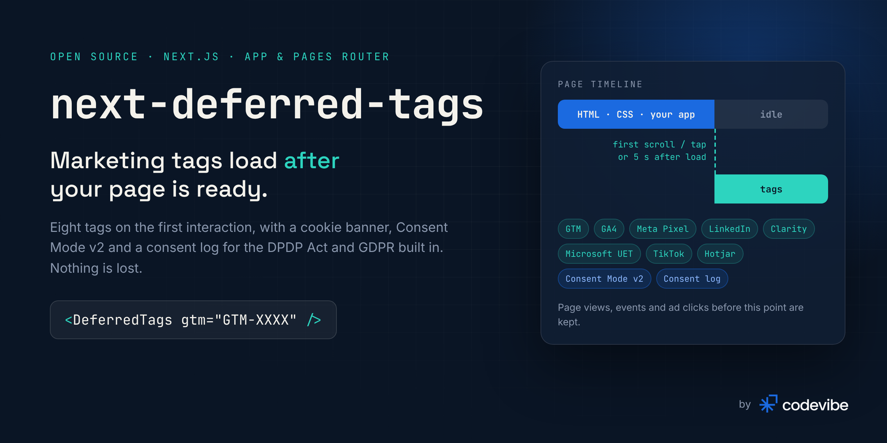
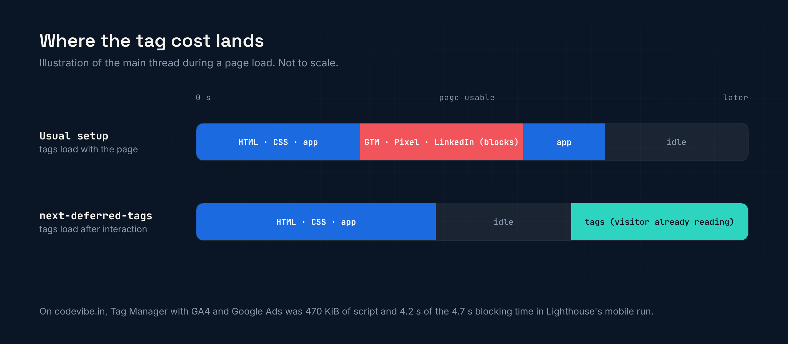
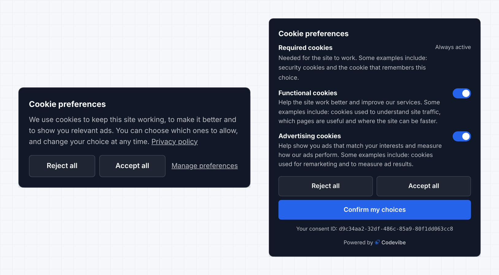

<p align="center">
  
</p>

<p align="center">
  <a href="https://www.npmjs.com/package/next-deferred-tags"></a>
  <a href="https://www.npmjs.com/package/next-deferred-tags"></a>
  <a href="https://github.com/codevibe-technology/next-deferred-tags/actions/workflows/ci.yml"></a>
  <a href="https://bundlephobia.com/package/next-deferred-tags"></a>
  
  <a href="LICENSE"></a>
</p>

<p align="center">
  <b>Keep Google Tag Manager, GA4, Meta, LinkedIn, Microsoft Clarity and UET, TikTok and Hotjar out of your page load,<br>without losing page views, events or ad clicks. Cookie consent, Google Consent Mode v2 and a consent log built in.</b>
</p>

<p align="center">
  <a href="https://codevibe.in/tools/next-deferred-tags?utm_source=github&utm_medium=readme&utm_campaign=next-deferred-tags&utm_content=video#video"></a><br>
  <sub>▶ <a href="https://codevibe.in/tools/next-deferred-tags?utm_source=github&utm_medium=readme&utm_campaign=next-deferred-tags&utm_content=video#video">Watch the full 76-second video with sound</a></sub>
</p>

<p align="center">
  <a href="#quick-start">Quick start</a> ·
  <a href="#why-this-exists">Why</a> ·
  <a href="#tags">Tags</a> ·
  <a href="#events-and-ad-clicks">Events</a> ·
  <a href="#cookie-consent">Consent</a> ·
  <a href="#consent-log">Consent log</a> ·
  <a href="#server-side-events">Server events</a> ·
  <a href="#props">Props</a> ·
  <a href="#trade-offs-honestly">Trade-offs</a> ·
  <a href="#faq">FAQ</a>
</p>

---

## Quick start

```bash
npm install next-deferred-tags
```

**App Router**, in `app/layout.tsx`:

```tsx
import { DeferredTags } from 'next-deferred-tags';

export default function RootLayout({ children }: { children: React.ReactNode }) {
  return (
    <html lang="en">
      <body>
        {children}
        <DeferredTags gtm="GTM-XXXXXXX" />
      </body>
    </html>
  );
}
```

**Pages Router**, in `pages/_app.tsx`:

```tsx
import type { AppProps } from 'next/app';
import { DeferredTags } from 'next-deferred-tags/pages';

export default function App({ Component, pageProps }: AppProps) {
  return (
    <>
      <Component {...pageProps} />
      <DeferredTags gtm="GTM-XXXXXXX" />
    </>
  );
}
```

That is the whole setup. Tag Manager now loads on the visitor's first scroll, tap or key press, or 5 seconds after the page has loaded, whichever comes first. Page views and events pushed before then are queued and replayed in order.

## Why this exists

Marketing tags are often the heaviest JavaScript on a Next.js marketing site, and with the usual setup they download and run **while the page is still loading**. That is exactly the window in which PageSpeed measures Total Blocking Time and Largest Contentful Paint, and in which a real visitor on a mid-range phone is waiting.

<p align="center">
  
</p>

On [codevibe.in](https://codevibe.in?utm_source=github&utm_medium=readme&utm_campaign=next-deferred-tags&utm_content=body), Tag Manager, with GA4 and Google Ads inside it, was **470 KiB of script and 4.2 s of the 4.7 s Total Blocking Time** in Lighthouse's mobile run. Deferring it, along with the LinkedIn Insight Tag, took third-party blocking time from 4,335 ms to 0 ms and was one of the changes that took the site from **54 to 99 on mobile PageSpeed**. The full story, including the other fixes, is in our [speed case study](https://codevibe.in/case-studies/website-speed-optimization?utm_source=github&utm_medium=readme&utm_campaign=next-deferred-tags&utm_content=case-study). This package is that component, generalised and tested. Our [Next.js tag loader page](https://codevibe.in/tools/next-deferred-tags?utm_source=github&utm_medium=readme&utm_campaign=next-deferred-tags&utm_content=tool-page) and [write-up](https://codevibe.in/blog/google-tag-manager-nextjs-performance?utm_source=github&utm_medium=readme&utm_campaign=next-deferred-tags&utm_content=blog) walk through the numbers.

## Features

- ⚡ **Nothing downloads during page load.** No tag `<script>` in the server HTML and no requests until the visitor interacts or the delay passes.
- 🧾 **No lost data.** The same queues the official snippets create (`dataLayer`, `gtag`, `fbq`, `lintrk`, `clarity`, `uetq`, `ttq`, `hj`) exist from the first render, so early page views and events are replayed in order.
- 🎯 **Ad clicks keep their credit.** `gclid`, `fbclid`, `msclkid`, `ttclid` and UTM tags from the landing page reach the tags even if the visitor moved on before they loaded.
- 🧭 **App Router and Pages Router.** Page views on every client-side navigation, de-duplicated for React Strict Mode.
- 🧩 **Eight vendors, one trigger.** GTM, GA4, Meta Pixel, LinkedIn Insight, Microsoft Clarity, Microsoft UET, TikTok Pixel, Hotjar and any extra scripts. Several ids per tag where it makes sense.
- 🍪 **Cookie consent built in.** Google Consent Mode v2 and each vendor's own consent API, an accessible `<ConsentBanner>` (English and Hindi), region rules, adapters for Cookiebot, OneTrust and IAB TCF tools, and a gate for YouTube or Maps embeds.
- 📒 **A consent log you can keep.** Store every choice in your own database or a Google Sheet and look up any visitor's history.
- 📮 **Server-side events.** Meta Conversions API and GA4 Measurement Protocol helpers, and a beacon for events queued by visitors who leave early.
- 🛠️ **Easy to debug.** GTM Preview connects at once, a `debug` log shows what loaded and when, and `onBlocked` tells you when an ad blocker stopped a script.
- 🔒 **CSP friendly**, **static pages stay static**, and **no dependencies** besides Next.js and React.

## Tags

```tsx
<DeferredTags
  gtm="GTM-XXXXXXX"
  metaPixel="1234567890"
  linkedin="1234567"
  clarity="abcd1234"
  uet="12345678"
  tiktok="CXXXXXXXXXXXXXXXXXXX"
  hotjar={1234567}
  scripts={['https://example.com/widget.js', { src: 'https://plausible.io/js/script.js', attributes: { 'data-domain': 'example.com' }, consent: 'analytics' }]}
/>
```

Use only the ones you need. If a vendor already runs inside Tag Manager, leave its prop out so it does not load twice.

| Prop | Tag | Consent it needs | Page views on navigation |
| --- | --- | --- | --- |
| `gtm` | Google Tag Manager | Consent Mode v2 (see below) | `{ event: 'pageview' }` on the dataLayer: add a Custom Event trigger |
| `ga4` | GA4 with gtag.js, without Tag Manager | Consent Mode v2 | GA4's enhanced measurement |
| `metaPixel` | Meta Pixel | Marketing | `PageView` |
| `linkedin` | LinkedIn Insight Tag | Marketing | LinkedIn's own tracking |
| `clarity` | Microsoft Clarity | Analytics (Clarity's consent API; cookieless before consent) | Clarity's own tracking |
| `uet` | Microsoft Advertising UET | Marketing (UET consent mode) | UET's SPA tracking |
| `tiktok` | TikTok Pixel | Marketing | `ttq.page()` |
| `hotjar` | Hotjar | Analytics (no consent API, so it waits) | Hotjar's own tracking |
| `scripts` | Anything else | `consent` on each entry, default marketing | |

**Several ids:** `gtm`, `ga4` and `metaPixel` accept arrays, for example two GA4 properties.

**GTM environments:** `gtmAuth` and `gtmPreview` from *Admin > Environments > Get snippet* load a staging container, so test traffic does not reach your live data.

**Server-side tagging:** `gtmScriptUrl="https://sst.example.com/gtm.js"` and `gtagScriptUrl` load Google's scripts from your own first-party domain.

## Events and ad clicks

```tsx
'use client';
import { newEventId, pushEvent, trackMetaEvent } from 'next-deferred-tags';

export function ContactForm() {
  async function onSubmit(form: FormData) {
    const eventId = newEventId();
    pushEvent('generate_lead', { form: 'contact' });             // dataLayer, for GTM or gtag
    trackMetaEvent('Lead', { content_name: 'contact' }, { eventId }); // Meta Pixel, with an id the server can reuse
    await fetch('/api/contact', { method: 'POST', body: JSON.stringify({ ...Object.fromEntries(form), eventId }) });
  }
  // ...
}
```

Every helper works before the tags load: the events wait in the queue. There are matching helpers for the other vendors: `trackTikTokEvent`, `trackUetEvent`, `clarityTag` and `hotjarEvent`.

**Ad click ids survive the delay.** Tags normally read `gclid`, `fbclid` and the rest from the URL when they load. With deferred tags the visitor may already be on another page by then. So `<DeferredTags>` reads them on the first render (`gclid`, `gbraid`, `wbraid`, `dclid`, `fbclid`, `ttclid`, `msclkid`, `li_fat_id`, `twclid` and the UTM tags, first touch per tab) and hands them over:

- the first page view carries `landing_page` and the ids, for Tag Manager variables;
- GA4 without Tag Manager gets the landing URL as `page_location`;
- the Meta Pixel gets an `_fbc` cookie built from the `fbclid`.

`getLanding()` returns them too, so you can send each lead's source with the form.

## Cookie consent

Laws like the GDPR and India's DPDP Act expect analytics and ad cookies to wait for the visitor's consent. Turn consent handling on with the `consent` prop and add the banner:

```tsx
// app/layout.tsx
import { DeferredTags, ConsentBanner } from 'next-deferred-tags';

<DeferredTags gtm="GTM-XXXXXXX" metaPixel="123" consent="stored" />
<ConsentBanner privacyHref="/privacy" />
```

Without the `consent` prop nothing changes: tags load on the trigger as above. You can use the package for deferred loading only and never touch consent.

What consent handling does:

- **Google Consent Mode v2.** Before Tag Manager or gtag.js loads, `analytics_storage`, `ad_storage`, `ad_user_data` and `ad_personalization` are `denied`, and updated the moment the visitor chooses. Every choice also pushes `{ event: 'consent_update', consent_analytics, consent_marketing }` for Tag Manager.
- **Clarity and UET** load with storage denied and switch to granted on consent, using their own consent APIs.
- **Meta, LinkedIn, TikTok, Hotjar and `scripts`** load only after the consent they need. On consent they load and record the current page.
- **`consentMode="basic"`** keeps Google, Clarity and UET out of the page entirely until the visitor accepts. The default `"advanced"` loads them with storage denied, so they can send cookieless pings.
- **`urlPassthrough`** turns on Consent Mode's URL passthrough, which helps measure ad conversions when ad cookies are denied.

If Tag Manager runs your Meta or LinkedIn tags, set those tags to *Require additional consent: ad_storage* (tag > Advanced settings > Consent settings) so they wait as well.

`consent` accepts `"stored"` (the choice saved by `<ConsentBanner>` or `setConsent()` in the first-party `ndt_consent` cookie, 12 months), a `{ analytics, marketing }` object from your own UI, or `null` (on, nothing chosen yet).

### Regions

Ask only where the law requires it. Outside the consent regions (default: EU and EEA, UK, Switzerland and India), tags run as if accepted and the banner does not open by itself. The visitor can still change it from a "Cookie settings" link. **When the country is unknown, consent is asked.**

The package cannot look up a visitor's country, but your host can. Set the `ndt_country` cookie in middleware, which keeps your pages static:

```ts
// middleware.ts
import { NextResponse, type NextRequest } from 'next/server';
import { COUNTRY_COOKIE, countryFromHeaders } from 'next-deferred-tags/server';

export function middleware(req: NextRequest) {
  const res = NextResponse.next();
  const country = countryFromHeaders(req.headers); // Vercel, Cloudflare, CloudFront and others
  if (country && req.cookies.get(COUNTRY_COOKIE)?.value !== country) res.cookies.set(COUNTRY_COOKIE, country, { path: '/', sameSite: 'lax' });
  return res;
}
```

Or pass `country` to `<DeferredTags>` and `<ConsentBanner>` yourself. `consentRegions` changes the list; `consentRegions="all"` asks everyone.

### The banner

<p align="center">
  
</p>

"Reject all" and "Accept all" carry equal weight, "Manage preferences" opens per-category switches that start off, and `openConsentSettings()` reopens it, for example from a footer link, so visitors can change or withdraw consent:

```tsx
'use client';
import { openConsentSettings } from 'next-deferred-tags';

export const CookieSettingsLink = () => <button onClick={openConsentSettings}>Cookie settings</button>;
```

| Prop | Default | Description |
| --- | --- | --- |
| `privacyHref` | | Link to your privacy or cookie policy |
| `text` | English | Replace any text. `CONSENT_TEXT_HI` is a full Hindi set |
| `categories` | `['analytics', 'marketing']` | Which optional categories to offer |
| `version` | `'1'` | Bump to ask everyone again (pass the same `consentVersion` to `<DeferredTags>`) |
| `onChoice` | | `(consent, action) => void` after every choice, for your [consent log](#consent-log) |
| `country`, `consentRegions` | | See [Regions](#regions) |
| `showConsentId` | `true` | After a choice, the settings view shows "Your consent ID", which visitors can quote when asking what they agreed to |
| `showTools` | `false` | Name the tools behind each category ("Used by: Google, Microsoft Clarity") |
| `poweredBy` | `true` | A small "Powered by Codevibe" link at the bottom of the settings view (never the first view). `false` removes it completely |
| `theme` | `'dark'` | `'dark'` or `'light'`; colours can also be set through the `--ndt-*` CSS variables |
| `position` | `'bottom-left'` | `'bottom-left'`, `'bottom-right'` or `'bottom'` |
| `unstyled` | `false` | Drop the built-in styles and style the `ndt-consent*` class names yourself |

### Another consent tool

Already using Cookiebot, OneTrust or an IAB TCF v2 tool (Google's own consent banner, Didomi, Quantcast and others)? Keep it, and let next-deferred-tags follow its choices:

```tsx
import { ConsentBridge } from 'next-deferred-tags/adapters';

<DeferredTags gtm="GTM-XXXXXXX" consent="stored" />
<ConsentBridge source="cookiebot" />   // or "onetrust" (with groups={{ analytics: ['C0002'], marketing: ['C0004'] }} if yours differ), or "tcf"
```

### Embeds

YouTube, Vimeo, Google Maps and social embeds set cookies as soon as they load. `<ConsentGate>` shows a placeholder with an "Allow and show" button until the visitor allows the category:

```tsx
import { ConsentGate } from 'next-deferred-tags';

<ConsentGate category="marketing">
  <iframe src="https://www.youtube-nocookie.com/embed/VIDEO_ID" title="Product tour" />
</ConsentGate>
```

## Consent log

Where consent is the basis for using data, India's DPDP Act puts the burden of proving that consent was given on the business, and the GDPR expects the same. So keep a permanent record of every choice.

**How it fits together:**

1. The visitor chooses in `<ConsentBanner>`. Their browser keeps the choice in the `ndt_consent` cookie, with a random consent ID that stays the same across later changes.
2. `onChoice` sends the record to your server.
3. `createConsentLogHandler` checks it and saves it, in your database or a Google Sheet. It stores the consent ID, version, choices, how they were made (accept all, reject all or custom), when, and the page. No IP address.
4. To answer "what did this person agree to?", ask them for the consent ID shown in their cookie settings and call `findByVisitor(id)`.

```tsx
// app/consent.tsx: onChoice is a function, so render the banner from a client component
'use client';
import { ConsentBanner } from 'next-deferred-tags';

export const Consent = () => (
  <ConsentBanner
    privacyHref="/privacy"
    onChoice={(consent, action) =>
      fetch('/api/consent', { method: 'POST', body: JSON.stringify({ ...consent, action }), keepalive: true })
    }
  />
);
```

**In your own database** (Postgres, MySQL or SQLite, through the client you already use; no extra dependency):

```ts
// lib/consent-log.ts
import { Pool } from 'pg';
import { sqlConsentLog } from 'next-deferred-tags/server';

const pool = new Pool();
export const consentLog = sqlConsentLog({ query: (sql, params) => pool.query(sql, params) }); // dialect: 'postgres' | 'mysql' | 'sqlite'
```

```ts
// app/api/consent/route.ts
import { createConsentLogHandler } from 'next-deferred-tags/server';
import { consentLog } from '@/lib/consent-log';

export const POST = createConsentLogHandler({ save: consentLog.save });
```

Run `consentLogSchema('postgres')` once, or add its `CREATE TABLE` to your migrations. You can then read the log with any database tool, or in code:

```ts
const history = await consentLog.findByVisitor('d9c34aa2-32df-486c-85a9-80f1dd063cc8');
// [{ visitorId, version, analytics, marketing, action, chosenAt, receivedAt, page }, ...] oldest first
```

**In a Google Sheet** (free and easy to read; fine for smaller sites): copy [`examples/consent-log-sheet/Code.gs`](examples/consent-log-sheet/Code.gs) into the sheet's Apps Script, follow the four setup steps at its top, then:

```ts
import { sheetsConsentLog } from 'next-deferred-tags/server';

export const consentLog = sheetsConsentLog({ url: process.env.CONSENT_SHEET_URL!, secret: process.env.CONSENT_SHEET_SECRET! });
```

Each choice becomes a row in the "Consent log" tab. Rows are only ever added, and every request needs the secret.

Do not keep the log in memory or in files: both are lost on a restart, and on serverless hosts files are wiped between requests.

## Server-side events

Some visitors never load the tags: they leave within the delay, or an ad blocker stops them. Send the conversions that matter from your server too. Import from `next-deferred-tags/server` in Route Handlers, Server Actions or API routes (Node and Edge):

```ts
// app/api/contact/route.ts
import { sendGa4Event, sendMetaEvent } from 'next-deferred-tags/server';

export async function POST(req: Request) {
  const { email, phone, eventId } = await req.json();
  // ...save the enquiry
  await sendMetaEvent(req, { name: 'Lead', eventId, email, phone, defaultCountryCode: '91' });
  return Response.json({ ok: true });
}
```

- **`sendMetaEvent`** sends to Meta's Conversions API. Email and phone are hashed (SHA-256) before they leave your server, and the same `eventId` as the browser event makes Meta count it once. Needs `META_PIXEL_ID` and `META_CAPI_TOKEN` (and `META_TEST_EVENT_CODE` while testing).
- **`sendGa4Event`** sends to the GA4 Measurement Protocol, joined to the visitor's session through the `_ga` cookie. Needs `GA4_MEASUREMENT_ID` and `GA4_API_SECRET`. GA4 does not de-duplicate, so use it for events the browser did not send.
- Both check the visitor's consent cookie first and send nothing without it. Both return `{ ok }` or the reason they skipped, and never throw.

**Events queued by visitors who leave early:** `<DeferredTags flushTo="/api/events" />` sends them (not page views) with `navigator.sendBeacon` when the page closes before the tags loaded. Receive them with `createFlushHandler`:

```ts
// app/api/events/route.ts
import { createFlushHandler, sendGa4Event } from 'next-deferred-tags/server';

export const POST = createFlushHandler({
  handle: async ({ events }, req) => {
    for (const e of events) if (e.event === 'generate_lead') await sendGa4Event(req, { name: 'generate_lead', params: { form: e.form } });
  },
});
```

## AI referrals

When a visit comes from ChatGPT, Perplexity, Claude, Gemini, Copilot, DeepSeek, Meta AI, Mistral, Grok or You.com (by referrer, or by the `utm_source` some assistants add, like `utm_source=chatgpt.com`), `<DeferredTags>` pushes once per visit:

```js
{ event: 'ai_referral', ai_assistant: 'ChatGPT', ai_source: 'chatgpt.com' }
```

In GA4, send it as an event with a Tag Manager trigger, or build a custom channel group. Turn it off with `aiReferrals={false}`.

## Debugging

- **GTM Preview:** Tag Assistant connects as usual. When the page is opened from Tag Assistant (or with `gtm_debug` in the URL), the tags load at once instead of waiting.
- **`debug`:** logs to the console when the tags are scheduled, which trigger loaded them, each script's load time, consent changes and page views.
- **`onBlocked={(tag, src) => ...}`:** called when a script fails to load, usually because of an ad blocker. A good moment to rely on [server-side events](#server-side-events).
- **`webVitals`:** pushes LCP, INP, CLS, FCP and TTFB to the dataLayer as `web_vitals` events, so you can see in GA4 that the tags did not slow your pages down.

`onLoad`, `onBlocked` and `onChoice` are functions, so pass them from a client component.

## Props

| Prop | Type | Default | Description |
| --- | --- | --- | --- |
| `gtm` | `string \| string[]` | | Tag Manager container id(s) |
| `ga4` | `string \| string[]` | | GA4 measurement id(s), for gtag.js without Tag Manager |
| `metaPixel` | `string \| string[]` | | Meta Pixel id(s) |
| `linkedin` | `string` | | LinkedIn Insight Tag partner id |
| `clarity` | `string` | | Microsoft Clarity project id |
| `uet` | `string` | | Microsoft Advertising UET tag id |
| `tiktok` | `string` | | TikTok Pixel id |
| `hotjar` | `string \| number` | | Hotjar site id |
| `scripts` | `Array<string \| { src, attributes?, consent? }>` | | Extra scripts to load at the same moment |
| `nonce` | `string` | | CSP nonce for every injected script |
| `gtmAuth`, `gtmPreview` | `string` | | GTM environment |
| `gtmScriptUrl`, `gtagScriptUrl` | `string` | Google's | Load Google's scripts from your own domain |
| `triggers` | `string[]` | `['pointerdown', 'keydown', 'touchstart', 'scroll']` | Window events that load the tags |
| `delay` | `number \| false` | `5000` | Load this many ms after `window.onload` even without interaction. `false` waits for an interaction only |
| `enabled` | `boolean` | `true` | Set `false` to hold everything back |
| `trackPageViews` | `boolean` | `true` | Push a page-view event on load and on every route change. Turn off if a GTM History Change trigger already counts them |
| `pageViewEvent` | `string` | `'pageview'` | dataLayer event name for page views |
| `consent` | `'stored' \| { analytics, marketing } \| null` | off | Turn on cookie consent handling |
| `consentMode` | `'advanced' \| 'basic'` | `'advanced'` | Whether tags with a consent mode load before consent (storage denied) or wait |
| `consentVersion` | `string` | `'1'` | With `consent="stored"`: bump to ask everyone again |
| `country` | `string` | `ndt_country` cookie | Visitor's country, for [region rules](#regions) |
| `consentRegions` | `string[] \| 'all'` | EU/EEA, UK, CH, IN | Where consent is asked |
| `urlPassthrough` | `boolean` | `false` | Google Consent Mode URL passthrough |
| `aiReferrals` | `boolean` | `true` | Push an `ai_referral` event for visits sent by AI assistants |
| `flushTo` | `string` | | Endpoint for events queued by visitors who leave before the tags load |
| `webVitals` | `boolean` | `false` | Push Core Web Vitals as `web_vitals` events |
| `debug` | `boolean` | `false` | Console log of what loads and when |
| `onLoad` | `(reason) => void` | | Called once after the scripts are added |
| `onBlocked` | `(tag, src) => void` | | Called when a script fails to load |

**Browser helpers:** `pushEvent`, `trackMetaEvent`, `trackTikTokEvent`, `trackUetEvent`, `clarityTag`, `hotjarEvent`, `newEventId`, `getLanding`, `loadTagsNow`, `tagsLoaded`, `setConsent`, `getConsent`, `openConsentSettings`, `detectAiReferral`, `consentRequired`, `readCountry`.

**Server helpers** (`next-deferred-tags/server`): `sendMetaEvent`, `sendGa4Event`, `createConsentLogHandler`, `sqlConsentLog`, `sheetsConsentLog`, `consentLogSchema`, `createFlushHandler`, `consentFromRequest`, `countryFromHeaders`.

**Building blocks** (framework-free, for your own wrapper): `scheduleOnInteraction`, `installStubs`, `loadTags`, `trackPageView`, `initConsent`, `updateConsent`, `consentModeSignals`, `readConsent`, `writeConsent`.

## How it works

1. **On mount** it creates the vendor queues the official snippets create, but adds no scripts. With consent handling on, the consent defaults go into each queue first. It also notes the landing page's click ids.
2. It pushes a page view for the current URL, and another on every client-side navigation.
3. It listens for the trigger events (passive, capture phase, once) and starts the fallback timer after `window.onload`.
4. On the first trigger it removes the listeners and the timer, then appends the vendor scripts the current consent allows, with `async`. Each script reads its queue when it starts. Scripts that still need consent are added the moment the visitor gives it.

State lives on `window.__nextDeferredTags`, so a second `<DeferredTags>` or a remount never loads anything twice.

## Trade-offs, honestly

- **Visitors who leave within the delay without interacting are not counted by the browser tags.** Someone who opens a page and closes it after 3 seconds without scrolling sends no hit. For most marketing sites that is a small slice of bounces. If every conversion matters, use [`flushTo` and server-side events](#server-side-events), or lower `delay`.
- **Lab scores improve partly because Lighthouse never interacts.** Real visitors still get the tags, just after the page has rendered and become usable, which is the point.
- **The package itself is small but not free.** `<DeferredTags>` alone is about 6 KB minified and gzipped in your bundle, and about 9 KB with `<ConsentBanner>`. It runs after the page loads, and CI fails if it grows past its budget.
- **The banner shows a "Powered by Codevibe" link** in its settings view by default. It is how this free package gets found. `poweredBy={false}` removes it.

## Compared with `@next/third-parties`

[`@next/third-parties`](https://www.npmjs.com/package/@next/third-parties) is the official way to add GTM and GA to Next.js and keeps the snippet tidy. It loads the script with `next/script`'s default `afterInteractive` strategy, right after hydration, so the tag cost still lands inside the load window PageSpeed measures. `next-deferred-tags` waits for an interaction or a delay instead, and handles several vendors, consent and route-change page views in one component. If the tags' load cost does not matter for your site, `@next/third-parties` is the simpler choice.

## FAQ

<details>
<summary><b>Is this just gaming Lighthouse?</b></summary>

No. Lighthouse does score better because it never scrolls, but the real benefit is for real visitors: the main thread is free while the page renders, and the tags run once the visitor is already reading. Every page view and event is still recorded for anyone who stays, interacts, or simply waits 5 seconds.
</details>

<details>
<summary><b>Do I have to use the cookie features?</b></summary>

No. Without the `consent` prop and the banner, the package only defers your tags. Consent, regions, the log and the server helpers are all opt-in.
</details>

<details>
<summary><b>Will my GTM triggers still fire?</b></summary>

Yes. Tag Manager processes the queued dataLayer in order when it loads, including the first `pageview`. Use a Custom Event trigger on `pageview` for page-view tags so client-side navigations are counted too.
</details>

<details>
<summary><b>Does the banner make my site compliant?</b></summary>

It gives you the technical parts: nothing optional before consent where consent is required, equal "Reject all" and "Accept all", switches that start off, a way to change your mind, and a log you can keep. Compliance also depends on your privacy policy, what your tags collect and where your visitors are, so check with your own adviser.
</details>

<details>
<summary><b>Can I load the tags earlier for some pages?</b></summary>

Yes: call `loadTagsNow()` wherever you need them immediately, or set a smaller `delay`.
</details>

## Examples

- [`examples/app-router`](examples/app-router): GTM, the Meta Pixel and LinkedIn with the consent banner.
- [`examples/pages-router`](examples/pages-router): the same with the Pages Router.
- [`examples/consent-log-sheet`](examples/consent-log-sheet): the Apps Script for a consent log in Google Sheets.

Releases are tested in a Next.js 15 app with Chrome, on both routers: no tag requests before interaction, every script after the first interaction or the 5-second fallback, queued events and client-side page views replayed in order, click ids kept across a navigation before the tags load, Consent Mode defaults before Tag Manager, consent-gated vendors held back until accepted, region rules, the banner reopened from a footer link, and the consent log saved and read back.

## Contributing

Contributions are welcome. See [CONTRIBUTING.md](.github/CONTRIBUTING.md).

```bash
git clone https://github.com/codevibe-technology/next-deferred-tags.git
cd next-deferred-tags
npm install
npm test        # unit tests
npm run build
npm run size    # browser bundle budget
```

## License

[MIT](LICENSE) © [Codevibe Technology](https://codevibe.in?utm_source=github&utm_medium=readme&utm_campaign=next-deferred-tags&utm_content=license)

---

<p align="center">
  <a href="https://codevibe.in?utm_source=github&utm_medium=readme&utm_campaign=next-deferred-tags&utm_content=footer-logo">
    <picture>
      <source media="(prefers-color-scheme: dark)" srcset=".github/assets/codevibe-logo-light.png">
      
    </picture>
  </a>
</p>

<p align="center">
  Built and maintained by <a href="https://codevibe.in?utm_source=github&utm_medium=readme&utm_campaign=next-deferred-tags&utm_content=built-by"><b>Codevibe</b></a>, a software development agency in Gurugram, India.<br>
  We build fast web apps, mobile apps and AI products for startups.<br>
  <a href="https://codevibe.in?utm_source=github&utm_medium=readme&utm_campaign=next-deferred-tags&utm_content=footer-links">Website</a> · <a href="https://codevibe.in/case-studies/website-speed-optimization?utm_source=github&utm_medium=readme&utm_campaign=next-deferred-tags&utm_content=footer-case-study">Speed case study</a> · <a href="mailto:hello@codevibe.in">hello@codevibe.in</a>
</p>
