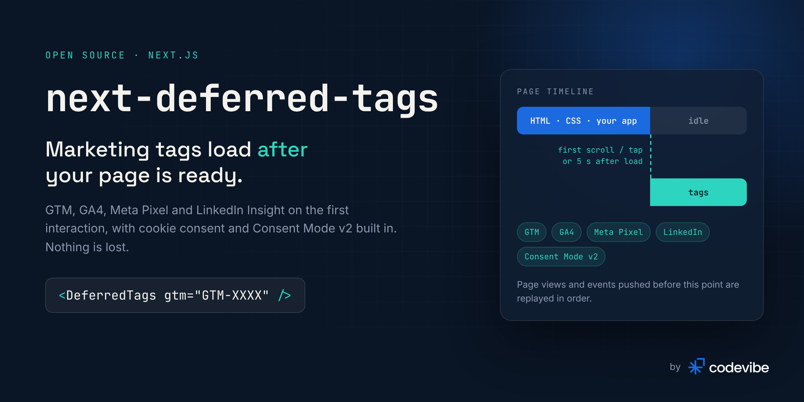
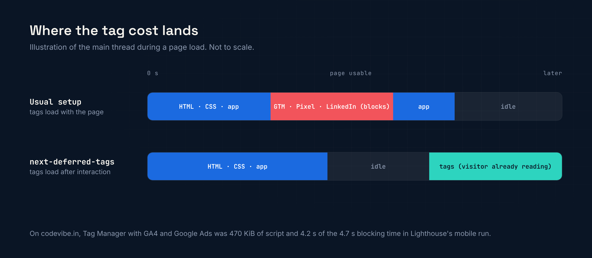

<p align="center">
  
</p>

<p align="center">
  <a href="https://www.npmjs.com/package/next-deferred-tags"></a>
  <a href="https://www.npmjs.com/package/next-deferred-tags"></a>
  <a href="https://github.com/codevibe-technology/next-deferred-tags/actions/workflows/ci.yml"></a>
  <a href="https://bundlephobia.com/package/next-deferred-tags"></a>
  
  <a href="LICENSE"></a>
</p>

<p align="center">
  <b>Keep Google Tag Manager, GA4, the Meta Pixel and LinkedIn Insight out of your page load,<br>without losing a single page view or event. Cookie consent and Google Consent Mode v2 built in.</b>
</p>

<p align="center">
  <a href="#quick-start">Quick start</a> ·
  <a href="#why-this-exists">Why</a> ·
  <a href="#features">Features</a> ·
  <a href="#usage">Usage</a> ·
  <a href="#cookie-consent">Consent</a> ·
  <a href="#props">Props</a> ·
  <a href="#trade-offs-honestly">Trade-offs</a> ·
  <a href="#faq">FAQ</a>
</p>

---

## Quick start

```bash
npm install next-deferred-tags
```

```tsx
// app/layout.tsx
import { DeferredTags } from 'next-deferred-tags';

export default function RootLayout({ children }: { children: React.ReactNode }) {
  return (
    <html lang="en">
      <body>
        {children}
        <DeferredTags gtm="GTM-XXXXXXX" />
      </body>
    </html>
  );
}
```

That is the whole setup. Tag Manager now loads on the visitor's first scroll, tap or key press, or 5 seconds after the page has loaded, whichever comes first. Page views and events pushed before then are queued and replayed in order.

## Why this exists

Marketing tags are often the heaviest JavaScript on a Next.js marketing site, and with the usual setup they download and run **while the page is still loading**. That is exactly the window in which PageSpeed measures Total Blocking Time and Largest Contentful Paint, and in which a real visitor on a mid-range phone is waiting.

<p align="center">
  
</p>

On [codevibe.in](https://codevibe.in?utm_source=github&utm_medium=readme&utm_campaign=next-deferred-tags&utm_content=body), Tag Manager, with GA4 and Google Ads inside it, was **470 KiB of script and 4.2 s of the 4.7 s Total Blocking Time** in Lighthouse's mobile run. Deferring it, along with the LinkedIn Insight Tag, took third-party blocking time from 4,335 ms to 0 ms and was one of the changes that took the site from **54 to 99 on mobile PageSpeed**. The full story, including the other fixes, is in our [speed case study](https://codevibe.in/case-studies/website-speed-optimization?utm_source=github&utm_medium=readme&utm_campaign=next-deferred-tags&utm_content=case-study). This package is that component, generalised and tested. Our [Next.js tag loader page](https://codevibe.in/tools/next-deferred-tags?utm_source=github&utm_medium=readme&utm_campaign=next-deferred-tags&utm_content=tool-page) and [write-up](https://codevibe.in/blog/google-tag-manager-nextjs-performance?utm_source=github&utm_medium=readme&utm_campaign=next-deferred-tags&utm_content=blog) walk through the numbers.

## Features

- ⚡ **Nothing downloads during page load.** No tag `<script>` in the server HTML and no requests until the visitor interacts or the delay passes.
- 🧾 **No lost data.** The same queues the official snippets create (`dataLayer`, `gtag`, `fbq`, `lintrk`) exist from the first render, so early page views and events are replayed in order. Tag Manager sees the first page view before `gtm.js`, exactly as with the standard snippet.
- 🧭 **Page views on client-side navigation.** Every route change pushes `{ event: 'pageview', page }`, de-duplicated for React Strict Mode.
- 🧩 **Several vendors, one trigger.** GTM, GA4 (gtag.js), Meta Pixel, LinkedIn Insight and any extra scripts.
- 🍪 **Cookie consent built in.** Google Consent Mode v2 with every signal denied until the visitor agrees, Meta Pixel and LinkedIn held back until marketing consent, and an optional accessible `<ConsentBanner>` (or bring your own). Choices are stored, can be changed any time, and can be logged on your server.
- 🤖 **AI referrals.** Visitors sent by ChatGPT, Perplexity, Claude, Gemini or Copilot get an `ai_referral` dataLayer event, so you can count them in GA4.
- 🔒 **CSP friendly.** Pass a `nonce` and it is added to every injected script.
- 📄 **Static pages stay static.** `useSearchParams` sits inside its own `Suspense`, so it does not force dynamic rendering.
- 🪶 **Tiny.** No dependencies besides Next.js and React.

## Usage

### Google Tag Manager

```tsx
<DeferredTags gtm="GTM-XXXXXXX" />
```

In GTM, create a **Custom Event** trigger for `pageview` and use it for page-view tags. Tags that should run once per load can stay on **Initialization - All Pages**.

### GA4 without Tag Manager

```tsx
<DeferredTags ga4="G-XXXXXXXXXX" />
```

GA4 sends its own `page_view` when it loads and tracks client-side navigation through enhanced measurement (on by default).

### Meta Pixel, LinkedIn Insight and other scripts

```tsx
<DeferredTags
  gtm="GTM-XXXXXXX"
  metaPixel="1234567890"
  linkedin="1234567"
  scripts={[
    'https://example.com/widget.js',
    { src: 'https://plausible.io/js/script.js', attributes: { 'data-domain': 'example.com' } },
  ]}
/>
```

If the Meta Pixel or LinkedIn already run through Tag Manager, pass only `gtm` so they are not loaded twice.

### Events

```tsx
'use client';
import { pushEvent, trackMetaEvent } from 'next-deferred-tags';

export function ContactForm() {
  async function onSubmit() {
    // ...send the form
    pushEvent('enquiry_submitted', { form: 'contact' }); // dataLayer, for GTM or gtag
    trackMetaEvent('Lead');                              // when metaPixel is configured directly
  }
  // ...
}
```

Both work before the tags have loaded. The events wait in the queue.

## Cookie consent

Laws like the GDPR and India's DPDP Act expect analytics and ad cookies to wait for the visitor's consent. Turn consent handling on with the `consent` prop:

```tsx
// app/layout.tsx
import { DeferredTags, ConsentBanner } from 'next-deferred-tags';

<DeferredTags gtm="GTM-XXXXXXX" metaPixel="123" linkedin="456" consent="stored" />
<ConsentBanner privacyHref="/privacy" />   // a client component; fine to render from a server layout
```

What changes:

- **Google Consent Mode v2.** Before Tag Manager or gtag.js loads, `analytics_storage`, `ad_storage`, `ad_user_data` and `ad_personalization` are set to `denied`, and updated the moment the visitor chooses. Google tags respect these signals by themselves.
- **Meta Pixel, LinkedIn Insight and `scripts`** load only after marketing consent. Until then the pixel is revoked and records nothing; on consent it loads and records the current page view.
- **Tag Manager is told too.** Every choice pushes `{ event: 'consent_update', consent_analytics, consent_marketing }`. If Tag Manager runs your Meta or LinkedIn tags, set those tags to *Require additional consent: ad_storage* (Tag Manager > tag > Advanced settings > Consent settings) so they wait as well.
- **`consentMode="basic"`** keeps Google tags out of the page entirely until the visitor accepts analytics or marketing. The default `"advanced"` loads them with signals denied, so Google can send cookieless pings for modelling.

`consent` accepts:

| Value | Meaning |
| --- | --- |
| `"stored"` | Use the choice saved by `<ConsentBanner>` or `setConsent()` (a first-party `ndt_consent` cookie, 12 months) and follow its changes |
| `{ analytics, marketing }` | The current choice from your own consent tool (OneTrust, Cookiebot, your own UI). Pass the new object when it changes |
| `null` | Consent handling on, the visitor has not chosen yet: everything optional is denied |

### The banner

`<ConsentBanner>` is small and accessible: "Reject all" and "Accept all" carry equal weight, "Choose" opens per-category switches, and it reopens with `openConsentSettings()`, for example from a footer link, so visitors can change or withdraw consent.

```tsx
'use client';
import { openConsentSettings } from 'next-deferred-tags';

export function CookieSettingsLink() {
  return <button onClick={openConsentSettings}>Cookie settings</button>;
}
```

**Keep a consent log.** Some laws expect you to be able to show that consent was given. `onChoice` receives the stored record (a random id that stays the same across changes, your `version`, a timestamp and the choices) and how it was made. Send it to your server. `onChoice` is a function, so render the banner from a client component:

```tsx
'use client';
import { ConsentBanner } from 'next-deferred-tags';

export const Consent = () => (
  <ConsentBanner
    privacyHref="/privacy"
    onChoice={(consent, action) =>
      navigator.sendBeacon('/api/consent', JSON.stringify({ ...consent, action, page: location.pathname }))
    }
  />
);
```

| Prop | Default | Description |
| --- | --- | --- |
| `privacyHref` | | Link to your privacy or cookie policy |
| `text` | English | Replace any text, or pass a full set for another language |
| `categories` | `['analytics', 'marketing']` | Which optional categories to offer |
| `version` | `'1'` | Bump to ask everyone again (pass the same `consentVersion` to `<DeferredTags>`) |
| `onChoice` | | `(consent, action) => void` after every choice, for your consent log |
| `theme` | `'dark'` | `'dark'` or `'light'`; colours can also be set through the `--ndt-*` CSS variables |
| `position` | `'bottom-left'` | `'bottom-left'`, `'bottom-right'` or `'bottom'` |
| `unstyled` | `false` | Drop the built-in styles and style the `ndt-consent*` class names yourself |

**Your own consent UI:** call `setConsent({ analytics, marketing })` when the visitor chooses, and `getConsent()` to read the saved choice. Or pass the choice straight to `<DeferredTags consent={...}>`.

**Hold everything instead:** `enabled={false}` still keeps every tag out until you flip it or call `loadTagsNow()`.

### AI referrals

When a visit comes from ChatGPT, Perplexity, Claude, Gemini, Copilot, DeepSeek, Meta AI, Mistral, Grok or You.com (by referrer, or by the `utm_source` some assistants add, like `utm_source=chatgpt.com`), `<DeferredTags>` pushes once per visit:

```js
{ event: 'ai_referral', ai_assistant: 'ChatGPT', ai_source: 'chatgpt.com' }
```

In GA4, send it as an event with a Tag Manager trigger, or build a custom channel group. Turn it off with `aiReferrals={false}`.

## Props

| Prop | Type | Default | Description |
| --- | --- | --- | --- |
| `gtm` | `string` | | Tag Manager container id |
| `ga4` | `string` | | GA4 measurement id, for gtag.js without Tag Manager |
| `metaPixel` | `string` | | Meta Pixel id |
| `linkedin` | `string` | | LinkedIn Insight Tag partner id |
| `scripts` | `Array<string \| { src, attributes? }>` | | Extra scripts to load at the same moment |
| `nonce` | `string` | | CSP nonce for every injected script |
| `triggers` | `string[]` | `['pointerdown', 'keydown', 'touchstart', 'scroll']` | Window events that load the tags |
| `delay` | `number \| false` | `5000` | Load this many ms after `window.onload` even without interaction. `false` waits for an interaction only |
| `enabled` | `boolean` | `true` | Set `false` to hold everything back, for example until consent |
| `trackPageViews` | `boolean` | `true` | Push a page-view event on load and on every route change |
| `pageViewEvent` | `string` | `'pageview'` | dataLayer event name for page views |
| `onLoad` | `(reason: string) => void` | | Called once after the scripts are added (`'scroll'`, `'timeout'`, `'manual'`...) |
| `consent` | `'stored' \| { analytics, marketing } \| null` | off | Turn on cookie consent handling (see [Cookie consent](#cookie-consent)) |
| `consentMode` | `'advanced' \| 'basic'` | `'advanced'` | Whether Google tags load before consent (with signals denied) or wait |
| `consentVersion` | `string` | `'1'` | With `consent="stored"`: bump to ask everyone again |
| `aiReferrals` | `boolean` | `true` | Push an `ai_referral` event for visits sent by AI assistants |

`scripts` entries can carry `consent: 'analytics' | 'marketing' | 'necessary'` (default `'marketing'`) to say which choice they need.

**Helpers:** `pushEvent`, `trackMetaEvent`, `loadTagsNow`, `tagsLoaded`, `setConsent`, `getConsent`, `openConsentSettings`, `detectAiReferral`.
**Building blocks** (framework-free, for your own wrapper): `scheduleOnInteraction`, `installStubs`, `loadTags`, `trackPageView`, `initConsent`, `updateConsent`, `consentModeSignals`, `readConsent`, `writeConsent`.

## How it works

1. **On mount** it creates the vendor queues the official snippets create (`dataLayer`, `gtag`, `fbq` with `init`, `lintrk`) but adds no scripts. With consent handling on, the Consent Mode defaults go into the queue first, before anything else.
2. It pushes a page view for the current URL, and another on every client-side navigation.
3. It listens for the trigger events (passive, capture phase, once) and starts the fallback timer after `window.onload`.
4. On the first trigger it removes the listeners and the timer, then appends the vendor scripts with `async`. Each script reads its queue when it starts. Scripts that still need consent are added the moment the visitor gives it.

State lives on `window.__nextDeferredTags`, so a second `<DeferredTags>` or a remount never loads anything twice.

## Trade-offs, honestly

- **Visitors who leave within the delay without interacting are not counted.** Someone who opens a page and closes it after 3 seconds without scrolling sends no hit. For most marketing sites that is a small slice of bounces. If every hit matters, lower `delay`, or also send key conversions server-side (GA4 Measurement Protocol, Meta Conversions API).
- **Lab scores improve partly because Lighthouse never interacts.** Real visitors still get the tags, just after the page has rendered and become usable, which is the point.
- **Tag Manager preview mode works**, but tags appear after your first scroll or click, not instantly.

## Compared with `@next/third-parties`

[`@next/third-parties`](https://www.npmjs.com/package/@next/third-parties) is the official way to add GTM and GA to Next.js and keeps the snippet tidy. It loads the script with `next/script`'s default `afterInteractive` strategy, right after hydration, so the tag cost still lands inside the load window PageSpeed measures. `next-deferred-tags` waits for an interaction or a delay instead, and handles several vendors and route-change page views in one component. If the tags' load cost does not matter for your site, `@next/third-parties` is the simpler choice.

## FAQ

<details>
<summary><b>Is this just gaming Lighthouse?</b></summary>

No. Lighthouse does score better because it never scrolls, but the real benefit is for real visitors: the main thread is free while the page renders, and the tags run once the visitor is already reading. Every page view and event is still recorded for anyone who stays, interacts, or simply waits 5 seconds.
</details>

<details>
<summary><b>Does it work with the Pages Router?</b></summary>

It is built and tested for the App Router (Next.js 13.4+). It uses `next/navigation`, which the Pages Router also supports, but that path is not tested yet. Reports are very welcome.
</details>

<details>
<summary><b>Will my GTM triggers still fire?</b></summary>

Yes. Tag Manager processes the queued dataLayer in order when it loads, including the first `pageview`. Use a Custom Event trigger on `pageview` for page-view tags so client-side navigations are counted too.
</details>

<details>
<summary><b>Does the banner make my site compliant?</b></summary>

It gives you the technical parts: nothing optional before consent, equal "Reject all" and "Accept all", a way to change your mind, and a record you can log. Compliance also depends on your privacy policy, what your tags collect and where your visitors are, so check with your own adviser.
</details>

<details>
<summary><b>Can I load the tags earlier for some pages?</b></summary>

Yes: call `loadTagsNow()` wherever you need them immediately, or set a smaller `delay`.
</details>

## Example

[`examples/app-router`](examples/app-router) is a minimal Next.js app with GTM, the Meta Pixel and LinkedIn. Releases are tested in a Next.js 15 app with Chrome: no tag requests before interaction, all scripts after the first scroll, the 5-second fallback without interaction, queued events and client-side page views replayed in order, and with `consent="stored"`: Consent Mode defaults before Tag Manager, Meta and LinkedIn held back until "Accept all", nothing but Tag Manager after "Reject all", the choice restored on reload, and the banner reopened from a footer link.

## Contributing

Contributions are welcome. See [CONTRIBUTING.md](.github/CONTRIBUTING.md).

```bash
git clone https://github.com/codevibe-technology/next-deferred-tags.git
cd next-deferred-tags
npm install
npm test        # unit tests for the scheduler and the vendor queues
npm run build
```

## License

[MIT](LICENSE) © [Codevibe Technology](https://codevibe.in?utm_source=github&utm_medium=readme&utm_campaign=next-deferred-tags&utm_content=license)

---

<p align="center">
  <a href="https://codevibe.in?utm_source=github&utm_medium=readme&utm_campaign=next-deferred-tags&utm_content=footer-logo">
    <picture>
      <source media="(prefers-color-scheme: dark)" srcset=".github/assets/codevibe-logo-light.png">
      
    </picture>
  </a>
</p>

<p align="center">
  Built and maintained by <a href="https://codevibe.in?utm_source=github&utm_medium=readme&utm_campaign=next-deferred-tags&utm_content=built-by"><b>Codevibe</b></a>, a software development agency in Gurugram, India.<br>
  We build fast web apps, mobile apps and AI products for startups.<br>
  <a href="https://codevibe.in?utm_source=github&utm_medium=readme&utm_campaign=next-deferred-tags&utm_content=footer-links">Website</a> · <a href="https://codevibe.in/case-studies/website-speed-optimization?utm_source=github&utm_medium=readme&utm_campaign=next-deferred-tags&utm_content=footer-case-study">Speed case study</a> · <a href="mailto:hello@codevibe.in">hello@codevibe.in</a>
</p>
